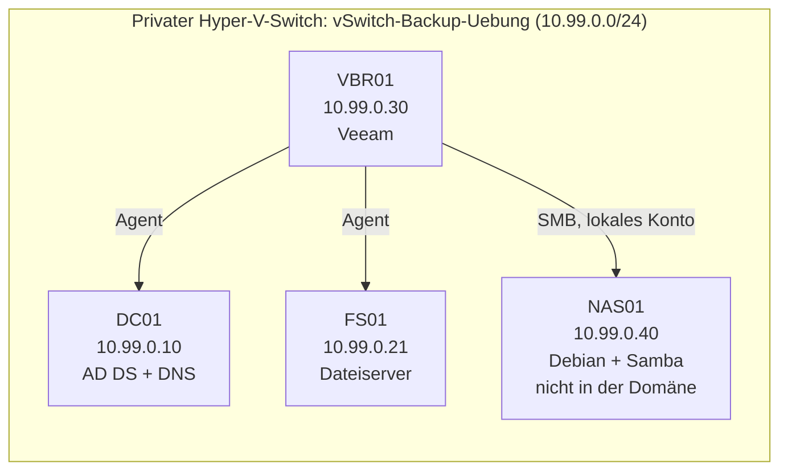

# 01.1 Backup auf NAS mit Veeam

| | |
|---|---|
| **Modul** | 01 Backup und Restore |
| **Stufe** | Aufbau |
| **Geschätzte Zeit** | 8 bis 10 Stunden (Schätzung), auf mehrere Tage verteilbar |
| **Werkzeuge** | Hyper-V, Windows Server (AD DS, Dateiserver), Veeam Backup & Replication Community Edition, Debian mit Samba, PowerShell 5.1 |
| **Vorwissen** | Grundlagen von Windows Server und Active Directory (Benutzer, OUs, Gruppen). Veeam-Kenntnisse sind nicht nötig. |

> [!WARNING]
> **Stand der Prüfung: Entwurf.** Die Skripte wurden getestet, aber nur mit nachgebauten Umgebungen (nachgebautes Active Directory, nachgebaute Veeam-Sitzungen, nachgebildete Samba-Aufrufe). **Veeam selbst wurde nicht ausgeführt.** Alle Menünamen, Schaltflächen und Ausgaben von Veeam stammen aus der Praxis (Stand Version 12) und sind nicht gegen die Dokumentation geprüft, soweit sie nicht unter „Quellen“ stehen. Neuere Versionen können anders heißen. Unsichere Stellen sind mit *nicht bestätigt* markiert. Alle Ausgaben in dieser Übung sind sinngemäß.

## Lernziele

Nach dieser Übung kannst du

- ein Backup-Ziel auf einem NAS-Nachbau einrichten, der bewusst **nicht** in der Domäne ist,
- zwei Windows-Server mit Veeam sichern, einen Dateiserver und einen Domänencontroller, mit anwendungskonsistenter Sicherung,
- eine einzelne Datei und ein gelöschtes Active-Directory-Objekt aus dem Backup zurückholen und das Ergebnis **nachweisen**, statt es nur zu glauben,
- die Konfiguration von Veeam selbst sichern und die Sicherungen täglich per Bericht kontrollieren,
- eine zweite Kopie außerhalb des NAS anlegen, ohne dass sie sich mit laufenden Sicherungen überschneidet,
- erklären, was die 3-2-1-Regel verlangt und was in dieser Übung davon nur nachgebildet ist.

## Voraussetzungen

- Ein Hyper-V-Host mit rund **16 GB freiem RAM** und etwa **200 GB freiem Speicher** (Schätzung, siehe Tabelle unten).
- ISO-Dateien für Windows Server mit Desktopdarstellung (eigene Lizenz oder Testversion) und für Debian.
- Ein kostenloses Konto bei Veeam, um die Software herunterzuladen. Die **Community Edition** ist nach Angaben von Veeam für bis zu 10 Workloads kostenlos und auch für den produktiven Einsatz erlaubt (siehe Quellen). Ohne Support.
- PowerShell-Grundkenntnisse.
- **Wichtig:** Die Übung läuft in einem **privaten Hyper-V-Switch ohne Verbindung nach außen**. Sie berührt weder ein bestehendes Active Directory noch ein echtes NAS oder das Heimnetz. Den Download der Veeam-Software machst du auf dem Host oder einem anderen Rechner und kopierst die ISO-Datei in die VM (siehe Schritt 3).

## Grundbegriffe

| Begriff | Bedeutung |
|---|---|
| **VBR** | Veeam Backup & Replication, der Server, der Sicherungen steuert. |
| **Repository** | Ort, an dem Veeam die Sicherungsdateien ablegt. Hier eine SMB-Freigabe auf dem NAS-Nachbau. |
| **Restore Point** | Ein Wiederherstellungspunkt, also ein gesicherter Zustand zu einem Zeitpunkt. |
| **Vollsicherung / Inkrement** | Die erste Sicherung enthält alles (`.vbk`), spätere nur die Änderungen (`.vib`). |
| **Retention** | Wie viele Restore Points aufbewahrt werden. |
| **Application-aware Processing** | Veeam spricht über den Schattenkopie-Dienst (VSS) mit dem Betriebssystem, damit Anwendungsdaten wie die AD-Datenbank in einem konsistenten Zustand gesichert werden. |
| **Agent** | Kleines Programm auf dem gesicherten Server, das Daten liest und an Veeam schickt. |
| **Protection Group** | Gruppe von Computern, auf denen Veeam die Agenten verwaltet. |
| **Explorer for Active Directory** | Veeam-Werkzeug, das einzelne AD-Objekte aus dem Backup öffnet und zurückschreibt. |
| **Configuration Backup** | Sicherung von Veeams eigener Konfiguration (Jobs, Repositories, Zugangsdaten). |
| **3-2-1** | Drei Kopien der Daten, auf zwei verschiedenen Medien, davon eine an einem anderen Ort. |
| **Immutability** | Unveränderlichkeit: Sicherungsdateien können für eine Frist weder geändert noch gelöscht werden. Nicht Teil der Basisübung. |

## Testumgebung und Adressplan

Vier VMs in einem privaten Netz. Namen und Domäne sind frei erfunden (`.example` ist für Beispiele reserviert).

<!-- tikz:topologie -->


| Gerät | Rolle | Adresse | DNS-Server | Domäne | Ressourcen (Schätzung) |
|---|---|---|---|---|---|
| DC01 | Domänencontroller, DNS | 10.99.0.10/24 | 10.99.0.10 | ja | 2 GB RAM, 40 GB |
| FS01 | Dateiserver (Testdaten) | 10.99.0.21/24 | 10.99.0.10 | ja | 2 GB RAM, 40 GB |
| VBR01 | Veeam-Server | 10.99.0.30/24 | 10.99.0.10 | ja | 4 vCPU, 8 GB RAM, 80 GB |
| NAS01 | Backup-Ziel (NAS-Nachbau) | 10.99.0.40/24 | keiner nötig | **nein** | 1 GB RAM, 8 GB + 40 GB + 40 GB |

NAS01 bekommt zwei zusätzliche virtuelle Festplatten: eine für die Sicherungen, eine als Nachbau der USB-Platte für die Offsite-Kopie.

| Angabe | Wert |
|---|---|
| Domäne (DNS) | `alpenwerk.example` |
| NetBIOS-Name | `ALPENWERK` |
| Freigabe auf NAS01 | `\\10.99.0.40\VeeamBackups` |
| Lokales NAS-Konto | `vbr_backup` |
| Dienstkonto für Veeam | `svc_veeam_backup` (Domäne) |

Kein Standardgateway, keine DHCP: Das Netz hat keinen Ausgang, alle Adressen sind fest vergeben.

## Aufgabe

Jeder Schritt steht, wo es sinnvoll ist, auf zwei Wegen: grafisch (GUI) und per PowerShell. Veeam selbst wird in dieser Übung über die grafische Konsole bedient. Dafür gibt es keinen zweiten Weg, außer beim Bericht (Schritt 12). PowerShell-Befehle werden, wenn nichts anderes steht, in einer PowerShell als Administrator eingegeben.

### Teil 0: Testumgebung aufbauen

**0.1 Privaten Switch anlegen und VMs anschließen**

- **GUI:** Hyper-V-Manager → *Manager für virtuelle Switches* → *Neuer virtueller Netzwerkswitch* → Typ *Privat* → Name `vSwitch-Backup-Uebung`. Alle vier VMs bekommen diesen Switch und sonst keinen.
- **PowerShell** (auf dem Hyper-V-Host):

```powershell
New-VMSwitch -Name 'vSwitch-Backup-Uebung' -SwitchType Private
Connect-VMNetworkAdapter -VMName 'DC01','FS01','VBR01','NAS01' -SwitchName 'vSwitch-Backup-Uebung'
```

**0.2 Domänencontroller einrichten (DC01)**

Installiere Windows Server auf DC01, vergib die feste Adresse aus dem Adressplan und richte die Domäne ein:

```powershell
New-NetIPAddress -InterfaceAlias 'Ethernet' -IPAddress 10.99.0.10 -PrefixLength 24
Set-DnsClientServerAddress -InterfaceAlias 'Ethernet' -ServerAddresses 10.99.0.10
Install-WindowsFeature AD-Domain-Services -IncludeManagementTools
Install-ADDSForest -DomainName 'alpenwerk.example' -DomainNetbiosName 'ALPENWERK' -InstallDns
```

Der Befehl fragt das DSRM-Kennwort ab und startet den Server neu. Der Adaptername kann abweichen (`Get-NetAdapter`).

**0.3 FS01 und VBR01 einrichten und in die Domäne aufnehmen**

Installiere Windows Server auf beiden VMs. Feste Adressen laut Plan (FS01 `10.99.0.21`, VBR01 `10.99.0.30`), DNS-Server jeweils `10.99.0.10`.

- **GUI:** *Einstellungen* → *System* → *Info* → *Domäne oder Arbeitsgruppe* → *Ändern* → Domäne `alpenwerk.example`, mit dem Domänenadministrator anmelden, neu starten.
- **PowerShell:**

```powershell
Add-Computer -DomainName 'alpenwerk.example' -Credential 'ALPENWERK\Administrator' -Restart
```

**0.4 NAS01 einrichten (Debian mit Samba)**

Installiere Debian (ohne Desktop reicht), vergib `10.99.0.40/24` und hänge die zwei zusätzlichen Festplatten an. Dann in der Konsole von NAS01:

```bash
lsblk                                # zeigt die neuen Platten, z. B. sdb und sdc
sudo mkfs.ext4 /dev/sdb              # Sicherungsplatte (Name an lsblk anpassen!)
sudo mkfs.ext4 /dev/sdc              # Offsite-Platte
sudo mkdir -p /srv/backup /mnt/offsite
sudo blkid /dev/sdb /dev/sdc         # UUIDs notieren
```

Trage beide Platten mit ihrer UUID in `/etc/fstab` ein (Beispiel, UUIDs durch deine ersetzen) und hänge sie ein:

```text
UUID=<UUID-von-sdb>  /srv/backup   ext4  defaults  0  2
UUID=<UUID-von-sdc>  /mnt/offsite  ext4  defaults  0  2
```

```bash
sudo mount -a && df -h /srv/backup /mnt/offsite
```

Kopiere dann `01.1-nas-einrichten.sh` und `01.1-offsite-kopie.sh` auf NAS01 und führe das erste aus:

```bash
sudo bash 01.1-nas-einrichten.sh
```

Das Skript installiert Samba, legt das lokale Konto `vbr_backup` ohne Login-Shell an, erzeugt den Ordner `/srv/backup/veeam` und trägt die Freigabe `VeeamBackups` ein. Es fragt das SMB-Kennwort ab. **Wähle ein eigenes Übungskennwort, das du sonst nirgends verwendest.**

Prüfen:

```bash
testparm -s | grep -A8 VeeamBackups
sudo smbclient -L localhost -U vbr_backup
```

**0.5 Dienstkonto für Veeam anlegen (auf DC01)**

```powershell
New-ADUser -Name 'svc_veeam_backup' -SamAccountName 'svc_veeam_backup' `
    -UserPrincipalName 'svc_veeam_backup@alpenwerk.example' `
    -AccountPassword (Read-Host -AsSecureString 'Kennwort fuer das Dienstkonto') `
    -Enabled $true -PasswordNeverExpires $true -Path 'CN=Users,DC=alpenwerk,DC=example'
Add-ADGroupMember -Identity 'Administrators' -Members 'svc_veeam_backup'
```

Die Mitgliedschaft in der Gruppe *Administrators* der Domäne gibt dem Konto Administratorrechte auf dem Domänencontroller und damit in der ganzen Domäne. Das ist für die Sicherung eines DC nötig, aber ein hohes Risiko (siehe Hintergrund und Erweiterungen). Für die Übung ist es in Ordnung.

**0.6 Übungsdateien bereitstellen**

Kopiere die Dateien nach `C:\Uebung` auf die Windows-Server: `01.1-testdaten-fileserver.ps1` auf FS01, `01.1-testdaten-ad.ps1` auf DC01, `01.1-backup-bericht.ps1` auf VBR01. Die Skripte sind mit UTF-8 (mit BOM) gespeichert, damit sie in der Windows PowerShell 5.1 richtig gelesen werden. Speichere sie beim Kopieren in derselben Kodierung.

> [!NOTE]
> Skripte aus dem Internet laufen nur, wenn die Ausführungsrichtlinie es erlaubt. In der Test-Domäne reicht für die laufende Sitzung: `Set-ExecutionPolicy -Scope Process -ExecutionPolicy RemoteSigned`. Bei als „aus dem Internet geladen“ markierten Dateien hilft `Unblock-File`.

### Teil 1: Backup einrichten

**1. Testdaten anlegen**

Ohne Daten gibt es nichts zu sichern und nichts zu vergleichen. Die Skripte legen erfundene Daten an und merken sich, wie sie aussehen sollen.

- Auf **FS01**:

```powershell
cd C:\Uebung
.\01.1-testdaten-fileserver.ps1 -Modus Anlegen -WhatIf
.\01.1-testdaten-fileserver.ps1 -Modus Anlegen
.\01.1-testdaten-fileserver.ps1 -Modus Pruefen
```

Erwartet (sinngemäß): 12 Dateien unter `C:\Daten` in vier Ordnern, eine Pruefliste `C:\Uebung\pruefliste.csv` mit einer SHA-256-Pruefsumme je Datei, bei `Pruefen` überall `OK`.

- Auf **DC01**:

```powershell
cd C:\Uebung
.\01.1-testdaten-ad.ps1 -Modus Anlegen
.\01.1-testdaten-ad.ps1 -Modus Sichern
```

Erwartet: die OU `Testbereich` mit der Gruppe `GG_Testbereich` und fünf Benutzern (`b.kern` bis `f.haas`), alle in der Gruppe. `Sichern` schreibt Name, SID, Abteilung und Gruppen nach `C:\Uebung\ad-vorher.csv`.

**2. Isolation des Backup-Ziels prüfen**

Das NAS-Nachbau-System soll ein gekapertes Domänenkonto nicht akzeptieren. Das prüfst du von **VBR01** aus, bevor Veeam ins Spiel kommt:

```powershell
Test-NetConnection 10.99.0.40 -Port 445
net use \\10.99.0.40\VeeamBackups /user:ALPENWERK\Administrator
net use \\10.99.0.40\VeeamBackups /user:vbr_backup
net use \\10.99.0.40\VeeamBackups /delete
```

Der erste Befehl muss `TcpTestSucceeded : True` zeigen. Der zweite Befehl (mit dem Domänenadministrator) soll **scheitern** (sinngemäß „Zugriff verweigert“ oder „Anmeldung fehlgeschlagen“). Der dritte (lokales NAS-Konto, Kennwort wird abgefragt) soll **gelingen**. Schreibe auf, was du siehst.

**3. Veeam auf VBR01 installieren**

- Lade die Software auf dem Host von der Veeam-Webseite (Anmeldung nötig). VBR01 hat keinen Internetzugang. Hänge die ISO-Datei im Hyper-V-Manager als DVD-Laufwerk in VBR01 ein und starte das Setup.
- Nimm die Standardwerte. Veeam bringt eine eigene Datenbank mit.
- Eine Lizenzdatei brauchst du nicht. Ohne Lizenz läuft Veeam nach meiner Kenntnis als Community Edition (*nicht bestätigt*, prüfe unter *Help → License Information*, was angezeigt wird).

> [!NOTE]
> Die Community Edition ist auf 10 Workloads begrenzt. Laut Veeam zählt ein Server mit Agent als 3 Instanzen, eine Arbeitsstation als 1 (Stand der Quelle: Juni 2024, siehe Quellen). In dieser Übung sind das 2 Server, also 6 Instanzen.

**4. Backup-Repository hinzufügen**

- In der Veeam-Konsole: *Backup Infrastructure* → *Backup Repositories* → *Add Repository* → *Network attached storage* → *SMB share*.
- Pfad: `\\10.99.0.40\VeeamBackups`
- Zugangsdaten: das **lokale NAS-Konto** `vbr_backup`, nicht ein Domänenkonto.
- Die übrigen Einstellungen bleiben auf den Standardwerten.

Erwartet: Das Repository erscheint in der Liste, Veeam zeigt den freien Platz an.

**5. Computer in eine Protection Group aufnehmen**

- *Inventory* → *Physical Infrastructure* → *Add Protection Group* → *Individual computers*.
- Füge `fs01.alpenwerk.example` und `dc01.alpenwerk.example` hinzu, mit den Zugangsdaten von `svc_veeam_backup`.
- Veeam installiert den Agenten auf beiden Servern. Warte, bis die Gruppe als fertig angezeigt wird.

Wenn die Verteilung scheitert: Prüfe die Namensauflösung (`nslookup fs01.alpenwerk.example` auf VBR01), die Windows-Firewall auf den Zielen und ob das Dienstkonto dort Administrator ist (*nicht bestätigt*, welche Firewallregeln Veeam genau braucht, siehe Hinweise).

**6. Sicherungsaufträge (Jobs) anlegen**

Lege zwei Jobs an: *Home* → *Jobs* → *Backup* → *Windows computer* → Typ *Server*, Modus *Managed by backup server*.

| Einstellung | Job_FS01 | Job_DC01 |
|---|---|---|
| Computer | FS01 | DC01 |
| Umfang | Gesamter Computer | Gesamter Computer |
| Repository | NAS-Repository aus Schritt 4 | NAS-Repository aus Schritt 4 |
| Restore Points | 7 | 7 |
| Application-aware Processing | **an** | **an** |
| Zugangsdaten für die Gastverarbeitung | `svc_veeam_backup` | `svc_veeam_backup` |
| Zeitplan | vorerst keiner (manuell) | vorerst keiner (manuell) |

Das Application-aware Processing bei DC01 ist entscheidend: Ohne die konsistente Sicherung der AD-Datenbank kann der Explorer for Active Directory später keine Objekte lesen.

**7. Jobs starten und Ergebnis prüfen**

- Starte beide Jobs (*Rechtsklick → Start*). Der erste Lauf ist eine Vollsicherung.
- Prüfe in der Konsole, dass beide Läufe mit *Success* enden. Bei *Warning* lies die Meldung, bevor du weitermachst.
- Prüfe auf **NAS01**, dass Dateien entstanden sind:

```bash
sudo ls -lh /srv/backup/veeam/*/
```

Erwartet (sinngemäß): je Job ein Unterordner mit einer `.vbk`-Datei (Vollsicherung) und einer `.vbm`-Datei (Metadaten). *Nicht bestätigt*: genaue Namen und Ordner.

- Ändere auf FS01 eine Datei (`Add-Content C:\Daten\IT\Notiz-2026-002.txt 'Zusatz'`), starte `Job_FS01` erneut und sieh auf NAS01 nach: Es entsteht eine kleine `.vib`-Datei (Inkrement). Notiere die Größe im Vergleich zur `.vbk`.

> [!NOTE]
> Das geänderte `Notiz-2026-002.txt` weicht jetzt von der Pruefliste ab. Das ist beabsichtigt, du brauchst es in Schritt 9.

**8. Jobs verketten**

Zwei Jobs sollen nicht gleichzeitig NAS und Server belasten.

- Öffne die Einstellungen von `Job_FS01` → *Schedule* → *Run the job automatically* → täglich um 22:00 Uhr.
- Öffne `Job_DC01` → *Schedule* → *Run the job automatically* → **After this job** → `Job_FS01`.

Nach meiner Kenntnis ist das die Kettung in Veeam (*nicht bestätigt* für Agent-Jobs). Wenn die Option fehlt, lege stattdessen zwei Uhrzeiten mit genug Abstand fest.

### Teil 2: Wiederherstellung

> [!WARNING]
> Mache vor Teil 2 einen Hyper-V-Prüfpunkt (Checkpoint) von DC01, FS01 und VBR01, falls du die Übung wiederholen willst. Bei nur **einem** Domänencontroller in der Testdomäne ist das nach meiner Erfahrung unkritisch. Mit mehreren Domänencontrollern gelten Prüfpunkte eines DC als problematisch (*nicht bestätigt*), für diese Übung ist das nicht relevant.

**9. Einzelne Datei zurückholen (File-Level Recovery)**

Ein Benutzer hat versehentlich eine Datei gelöscht, und eine andere wurde nach der letzten Sicherung verändert.

1. Auf **FS01** den Ausfall herstellen und den Zustand zeigen:

```powershell
cd C:\Uebung
.\01.1-testdaten-fileserver.ps1 -Modus Loeschen -Datei Vertrieb/Angebot-2026-001.txt -WhatIf
.\01.1-testdaten-fileserver.ps1 -Modus Loeschen -Datei Vertrieb/Angebot-2026-001.txt
.\01.1-testdaten-fileserver.ps1 -Modus Pruefen
```

Erwartet: `FEHLT Vertrieb/Angebot-2026-001.txt` und `ABWEICHEND IT/Notiz-2026-002.txt`, Rückgabewert 1.

2. In Veeam auf **VBR01**: *Home* → *Backups* → *Disk* → `Job_FS01` → Rechtsklick auf FS01 → *Restore guest files* (Microsoft Windows). Veeam wählt einen Restore Point, wähle den **ersten** (die Sicherung vor der Änderung an `Notiz-2026-002.txt`), falls mehrere angeboten werden.
3. Im sich öffnenden Datei-Explorer von Veeam zu `C:\Daten` navigieren. Rechtsklick auf `Vertrieb\Angebot-2026-001.txt` → *Restore* (an den ursprünglichen Ort) oder *Copy to* (in einen anderen Ordner). Dasselbe für `IT\Notiz-2026-002.txt`.
4. Auf **FS01** prüfen:

```powershell
.\01.1-testdaten-fileserver.ps1 -Modus Pruefen
```

Erwartet: überall `OK`. Wenn eine Datei `ABWEICHEND` bleibt, hast du den falschen Restore Point gewählt. Das ist der Grund für die Prüfsummen: Das Ergebnis wird bewiesen, nicht geglaubt.

**10. Gelöschte OU zurückholen (Active Directory Object Recovery)**

Jemand hat versehentlich die OU `Testbereich` mit allen Benutzern gelöscht.

1. **Voraussetzung prüfen:** `Job_DC01` lief nach dem Anlegen der Testdaten (Schritt 1) erfolgreich durch. Wenn nicht, starte ihn jetzt.
2. Auf **DC01** den Ausfall herstellen:

```powershell
cd C:\Uebung
.\01.1-testdaten-ad.ps1 -Modus Loeschen -WhatIf
.\01.1-testdaten-ad.ps1 -Modus Loeschen
.\01.1-testdaten-ad.ps1 -Modus Vergleichen
```

Das Skript fragt vor dem Löschen nach (mit `-Force` entfällt die Frage). Erwartet: `FEHLT` für alle fünf Konten.

3. **Gegenprobe:** Lege die Konten einfach neu an und vergleiche:

```powershell
.\01.1-testdaten-ad.ps1 -Modus Anlegen
.\01.1-testdaten-ad.ps1 -Modus Vergleichen
```

Erwartet: Die Konten sind wieder da, aber `ABWEICHEND: SID` (die SID ist neu, siehe Hintergrund). Lösche die OU danach wieder (`-Modus Loeschen`), damit der Ausfall wieder besteht.

4. In Veeam auf **VBR01**: *Home* → *Backups* → *Disk* → `Job_DC01` → Rechtsklick auf DC01 → *Restore application items* → *Microsoft Active Directory objects*. Der **Veeam Explorer for Microsoft Active Directory** öffnet sich und liest die AD-Datenbank aus dem Backup.
5. Navigiere zur OU `Testbereich`, Rechtsklick → *Restore* (nach meiner Kenntnis stellt Veeam dabei zuerst den Container und dann die Objekte darin wieder her, *nicht bestätigt*). Das Menü kann bei anderer Version anders heißen. Wenn ein Vergleich mit dem laufenden AD angeboten wird (*Compare with production*, *nicht bestätigt*), probiere ihn aus.
6. Auf **DC01** prüfen:

```powershell
.\01.1-testdaten-ad.ps1 -Modus Vergleichen
Get-ADUser -Filter * -SearchBase 'OU=Testbereich,DC=alpenwerk,DC=example' -Properties PasswordLastSet, Enabled | Select-Object SamAccountName, Enabled, PasswordLastSet
```

Schreibe auf: Stimmen SID, Abteilung und Gruppen mit der Sicherung überein? Sind die Konten aktiviert? Was ist mit dem Kennwort? **Trage ein, was du tatsächlich siehst**, auch wenn es von der Musterlösung abweicht.

### Teil 3: Betrieb

**11. Die Konfiguration von Veeam selbst sichern**

Wenn VBR01 ausfällt, sind Jobs, Repositories und gespeicherte Zugangsdaten weg, auch wenn die Sicherungsdateien auf dem NAS liegen.

- In der Veeam-Konsole: Hauptmenü (Hamburger-Menü oben links) → *Configuration Backup*.
- Aktivieren, Repository: das NAS-Repository, Aufbewahrung 7 Wiederherstellungspunkte (Schätzwert), täglicher Zeitplan zu einer Zeit, in der keine Backup-Jobs laufen.
- **Verschlüsselung einschalten und ein Kennwort setzen.** Laut Veeam-Dokumentation ist die Verschlüsselung Pflicht, sobald im Passwortmanager des Servers mindestens ein Kennwort gespeichert ist. Ohne diese Sicherung ist die Konfiguration nicht wiederherstellbar. Bewahre das Kennwort **nicht auf VBR01** auf, sondern an einem anderen Ort (zum Beispiel Passwortmanager).
- Starte die Sicherung manuell (*Backup Now*) und sieh auf NAS01 nach, ob eine neue Datei entstanden ist (Endung vermutlich `.bco`, *nicht bestätigt*).

**12. Täglichen Bericht einrichten (VBR01)**

```powershell
cd C:\Uebung
.\01.1-backup-bericht.ps1 -ErwarteteJobs 'Job_FS01','Job_DC01'
```

Erwartet (sinngemäß): eine Zeile je Sitzung mit Ergebnis, Job, Startzeit und Dauer in Minuten, am Ende `Ergebnis: Alles in Ordnung. (Rueckgabewert 0)`. Die CSV-Datei liegt in `C:\Uebung\veeam-bericht.csv`.

Wenn das Skript einen Fehler wegen fehlender Eigenschaften oder des Moduls meldet: Der Modulname und die Eigenschaftsnamen sind *nicht bestätigt*. Prüfe mit `Get-Module -ListAvailable *Veeam*` und `Get-VBRBackupSession | Select-Object -First 1 | Get-Member`, wie sie bei dir heißen, und passe das Skript an. Notiere die Abweichung.

Einmal pro Tag ausführen:

- **GUI:** *Aufgabenplanung* → *Einfache Aufgabe erstellen* → täglich 07:00 → Programm `powershell.exe`, Argumente `-NoProfile -ExecutionPolicy Bypass -File C:\Uebung\01.1-backup-bericht.ps1 -ErwarteteJobs Job_FS01,Job_DC01`. Wähle ein Konto, das in Veeam Administratorrechte hat.
- **PowerShell:**

```powershell
$aktion = New-ScheduledTaskAction -Execute 'powershell.exe' -Argument '-NoProfile -ExecutionPolicy Bypass -File C:\Uebung\01.1-backup-bericht.ps1 -ErwarteteJobs Job_FS01,Job_DC01'
$zeit = New-ScheduledTaskTrigger -Daily -At 7am
Register-ScheduledTask -TaskName 'Veeam-Bericht' -Action $aktion -Trigger $zeit -User 'SYSTEM' -RunLevel Highest
```

Ob das Konto `SYSTEM` in Veeam lesen darf, ist *nicht bestätigt*. Bleibt der Bericht leer, hinterlege in der Aufgabe das Konto, mit dem du dich an der Veeam-Konsole anmeldest.

**13. Offsite-Kopie auf das zweite Laufwerk (NAS01)**

Das zweite Laufwerk ist der Nachbau der USB-Platte. Das Skript kopiert nur, wenn das Ziel eingehängt ist und gerade niemand in die Freigabe schreibt.

```bash
sudo bash 01.1-offsite-kopie.sh --dry-run
sudo bash 01.1-offsite-kopie.sh
sudo tail /var/log/offsite-kopie.log
ls -lh /mnt/offsite
```

Zeitplan (einmal pro Woche, sonntags 03:00 Uhr, wenn kein Veeam-Job läuft):

```bash
echo '0 3 * * 0 root bash /root/01.1-offsite-kopie.sh' | sudo tee /etc/cron.d/offsite-kopie
```

Das Skript muss dafür unter `/root/` liegen. Prüfe die Schutzfunktion: Starte einen Veeam-Job und rufe das Skript währenddessen auf. Es soll mit „ABBRUCH“ und Rückgabewert 2 enden (*nicht bestätigt* für Samba, siehe Hinweise).

**14. Aufräumen**

Die Testumgebung ist bewusst wegwerfbar. Lösche die vier VMs samt Festplatten und den Switch, wenn du fertig bist:

```powershell
Remove-VMSwitch -Name 'vSwitch-Backup-Uebung' -Force
```

(Die VMs vorher im Hyper-V-Manager löschen und die Festplattendateien entfernen.)

## Hintergrund: Was passiert da eigentlich?

### 3-2-1 und was die Übung davon nachbildet

Die Regel lautet: drei Kopien, zwei Medien, eine außerhalb. In der Übung sind die Daten auf FS01 (Kopie 1), auf dem NAS (Kopie 2) und auf dem Offsite-Laufwerk (Kopie 3). Zwei Medien und ein anderer Ort sind aber nur **nachgebildet**: Alle Platten sind virtuelle Dateien auf demselben Host. In der Praxis wäre das Offsite-Laufwerk eine echte externe Platte, die woanders liegt. Die Übung zeigt die Technik, nicht den Schutz vor Feuer oder Diebstahl.

### Warum das NAS nicht in der Domäne ist

Ransomware nutzt oft ein gekapertes Domänenkonto, um sich im Netz zu verbreiten. Gehört das Backup-Ziel zur Domäne, kann dasselbe Konto auch die Sicherungen verschlüsseln oder löschen. Ein Backup-Ziel mit **eigenem lokalem Konto**, das in keiner Domänengruppe vorkommt, hält diesen Weg zu. Der Test in Schritt 2 zeigt das direkt: Der Domänenadministrator kommt nicht hinein. Das ersetzt keine Unveränderlichkeit (siehe Erweiterungen), aber es ist der erste Riegel.

### Anwendungskonsistente Sicherung

Eine Datenbank, die gerade geschrieben wird, ist beim Kopieren in einem undefinierten Zustand. Windows hat dafür den Schattenkopie-Dienst (VSS): Er sorgt dafür, dass Anwendungen kurz einen konsistenten Zustand herstellen. *Application-aware Processing* nutzt das. Beim Domänencontroller betrifft das die AD-Datenbank. Ohne diesen Schritt ist die Sicherung eher ein „Absturz-Abbild“, das sich meist wiederherstellen lässt, aber ohne Garantie. Der Explorer for Active Directory braucht die konsistente Sicherung.

### Sicherungsketten

Die erste Sicherung ist vollständig, die folgenden enthalten nur Änderungen. Beim Wiederherstellen setzt Veeam den Stand aus der Vollsicherung und den Inkrementen bis zum gewünschten Punkt zusammen. Das schont das NAS beim Schreiben. Bei langen Ketten ist das Lesen aufwendiger, deshalb gibt es regelmäßige neue Vollsicherungen. Veeam kennt auch andere Verfahren (etwa umgekehrte Inkremente mit besonders hoher Schreiblast). Welche davon für Agent-Jobs verfügbar sind, hängt von der Version ab (*nicht bestätigt*).

### Das Dienstkonto und sein Risiko

Zum Sichern eines Domänencontrollers braucht Veeam ein Konto mit weitreichenden Rechten. Auf einem DC sind lokale Administratoren Administratoren der ganzen Domäne. Wer dieses Konto übernimmt, hat die Domäne. Deshalb gilt: eigenes Konto nur für diesen Zweck, langes Kennwort, keine interaktive Anmeldung (zum Beispiel per Gruppenrichtlinie „Lokale Anmeldung verweigern“, siehe Erweiterungen) und kein Gebrauch für den Alltag.

### Warum die SID zählt

Rechte hängen an der SID, nicht am Namen. Ein neu angelegtes Konto mit demselben Namen bekommt eine **neue SID**. Gruppenmitgliedschaften, Berechtigungen auf Ordnern und Zuordnungen in Anwendungen zeigen aber auf die alte. Darum reicht „einfach neu anlegen“ nicht, und darum zeigt dein Vergleich in Schritt 10 `ABWEICHEND: SID`. Eine Wiederherstellung aus dem Backup holt das ursprüngliche Objekt zurück. Ob dabei **alle** Eigenschaften, etwa das Kennwort, zurückkommen, prüfst du selbst.

### Ein Restore-Test gehört dazu

Ein Backup, das nie zurückgespielt wurde, ist eine Vermutung. Darum prüfen die Skripte das Ergebnis mit Prüfsummen und AD-Vergleich, statt auf „sieht gut aus“ zu vertrauen. In der Praxis wiederholt man Restore-Tests regelmäßig.

### Die Konfigurationssicherung

Die Sicherungsdateien allein helfen nach einem Totalausfall von VBR01 wenig, wenn niemand mehr weiß, welche Jobs es gab und mit welchen Zugangsdaten. Die Konfigurationssicherung enthält genau das. Weil dort Zugangsdaten stehen, ist sie verschlüsselt, und das Kennwort muss an einem anderen Ort liegen.

### Offsite-Kopie ohne Löschen

Das Skript nutzt `rsync` ohne `--delete`. Gelöschte Quelldateien bleiben auf dem Offsite-Laufwerk. So reicht ein Fehler (oder Ransomware) auf der Quelle nicht, um auch die Kopie zu leeren. Der Preis: Das Laufwerk füllt sich, und Aufräumen ist eine bewusste Handlung. Außerdem darf die Kopie nicht laufen, während Veeam schreibt, sonst kopiert man halbfertige Dateien.

### Was die Community Edition begrenzt

Die kostenlose Edition ist laut Veeam auf 10 Workloads begrenzt, mit dem Hinweis, dass ein Server mit Agent mehrere Instanzen zählt. Wichtige Funktionen für diese Übung (Application-aware Processing, Explorer for Active Directory, Backup-Kopier-Aufträge) sind nach Angaben von Veeam enthalten. Welche Funktionen genau fehlen (zum Beispiel für Unveränderlichkeit), ist hier **nicht bestätigt**.

## Hinweise

- Veeam zeigt Fehler und Warnungen im Reiter *History* je Sitzung mit Text. Lies sie, bevor du etwas änderst.
- Wenn die Agentenverteilung scheitert, prüfe Namensauflösung, Windows-Firewall (Datei- und Druckerfreigabe sowie Fernverwaltung sind typische Kandidaten, *nicht bestätigt*) und die Rechte des Dienstkontos.
- Zeitgleich laufende Jobs, Offsite-Kopie und Konfigurationssicherung brauchen getrennte Zeitfenster.
- Die Prüfsummen vergleichen Inhalte. Änderungsdatum und Berechtigungen prüfen sie nicht.
- Führe `-Modus Anlegen` auf FS01 nicht erneut aus, nachdem du Dateien verändert hast: Es schreibt die Dateien wieder im Ausgangszustand und die Pruefliste neu. Danach wäre jede Abweichung verschwunden.
- Veeam-Menüs ändern sich zwischen Versionen. Wenn ein Name nicht stimmt, suche nach dem Sinn, nicht nach dem Wort.

## Prüfbefehle

| Aufgabe | Befehl | Ort |
|---|---|---|
| Domäne und DC erreichbar | `nslookup alpenwerk.example` | VBR01, FS01 |
| NAS-Port offen | `Test-NetConnection 10.99.0.40 -Port 445` | VBR01 |
| Samba-Konfiguration | `testparm -s` | NAS01 |
| Freigabe sichtbar | `sudo smbclient -L localhost -U vbr_backup` | NAS01 |
| Sicherungsdateien | `sudo ls -lh /srv/backup/veeam/*/` | NAS01 |
| Datenbestand prüfen | `.\01.1-testdaten-fileserver.ps1 -Modus Pruefen` | FS01 |
| AD-Zustand prüfen | `.\01.1-testdaten-ad.ps1 -Modus Vergleichen` | DC01 |
| Sicherungsbericht | `.\01.1-backup-bericht.ps1 -ErwarteteJobs ...` | VBR01 |
| Offsite-Kopie | `sudo tail /var/log/offsite-kopie.log` | NAS01 |
| Ereignisse zum Löschen von OU und Benutzer (DC) | Ereignisanzeige → Sicherheit → Ereignis-ID 5141, 4726 | DC01 |

Die Ereignis-IDs 4726 (Benutzerkonto gelöscht) und 5141 (Verzeichnisdienstobjekt gelöscht) sind *nicht gegen die Dokumentation geprüft*. Prüfe, ob die Überwachung überhaupt eingeschaltet ist.

**Kontrollfragen**

1. Warum steht das NAS nicht in der Domäne, und wie hast du das in Schritt 2 gezeigt?
2. Was ist der Unterschied zwischen einer `.vbk`- und einer `.vib`-Datei, und was bedeutet das für den Restore?
3. Warum braucht der Explorer for Active Directory das Application-aware Processing?
4. Warum reicht es nicht, ein gelöschtes Konto einfach neu anzulegen?
5. Warum ist ein Restore-Test mit Prüfsummen besser als „die Datei ist wieder da“?
6. Warum läuft die Offsite-Kopie ohne `--delete`, und was ist die Folge?
7. Was geht verloren, wenn du die Konfigurationssicherung nicht verschlüsselst, und was, wenn du das Kennwort dazu auf VBR01 ablegst?
8. Welche Teile der 3-2-1-Regel sind in dieser Übung nur nachgebildet?

## Erweiterungen

- **Unveränderliche Sicherungen:** Ein Linux-Repository mit Unveränderlichkeit (Hardened Repository). Anforderungen und Einrichtung hängen von der Version ab, siehe Veeam-Dokumentation (*nicht bestätigt*).
- **Sicherung auf Hypervisor-Ebene:** Statt Agenten die VMs selbst über einen Hyper-V-Host sichern. In dieser isolierten Umgebung bräuchte das einen verschachtelten Hyper-V-Host.
- **Dienstkonto absichern:** Per Gruppenrichtlinie dem Konto die lokale und die Remote-Desktop-Anmeldung verweigern.
- **Gelöschte Objekte ohne Backup:** Den AD-Papierkorb aktivieren und gelöschte Objekte damit zurückholen. Vergleiche Aufwand und Ergebnis mit dem Veeam-Restore.
- **Backup Copy Job:** Eine zweite Kopie mit Veeam statt mit `rsync` anlegen.
- **Komplettausfall:** VBR01 löschen, neu installieren und die Konfiguration aus der Konfigurationssicherung zurückholen.
- **Bericht per Mail:** Den Bericht an eine Mailadresse senden (benötigt einen Mailserver, in der isolierten Umgebung nicht vorhanden).

## Musterlösung

<details>
<summary>Musterlösung anzeigen</summary>

### Erwartete Zustände

| Schritt | Erwartung |
|---|---|
| 1 | FS01: 12 Dateien, Pruefung `OK`. DC01: OU `Testbereich`, 5 Benutzer in `GG_Testbereich`, CSV geschrieben. |
| 2 | Port 445 offen. `net use` mit Domänenadministrator scheitert, mit `vbr_backup` gelingt. |
| 4 | Repository `\\10.99.0.40\VeeamBackups` mit lokalem Konto, nicht mit Domänenkonto. |
| 6 | Beide Jobs: 7 Restore Points, Application-aware Processing an. |
| 7 | Beide Läufe *Success*. Auf NAS01 je Job eine `.vbk`, nach dem zweiten Lauf von `Job_FS01` zusätzlich eine kleine `.vib`. |
| 9 | Vor dem Restore: `FEHLT` und `ABWEICHEND`. Nach dem Restore aus dem **ersten** Restore Point: alles `OK`. |
| 10 | Nach dem Löschen: 5 × `FEHLT`. Nach dem Neuanlegen: `ABWEICHEND: SID`. Nach dem Restore aus dem Backup: Zustand prüfen und beschreiben. |
| 11 | Konfigurationssicherung verschlüsselt, Datei auf NAS01 vorhanden. |
| 12 | Bericht: `Alles in Ordnung (Rueckgabewert 0)`. Aufgabe eingerichtet. |
| 13 | Probelauf ohne Fehler, danach Dateien auf `/mnt/offsite`. Bei laufendem Job: `ABBRUCH`, Rückgabewert 2. |

### Antworten auf die Kontrollfragen

1. Ein Domänenkonto soll das Backup-Ziel nicht erreichen. In Schritt 2 scheitert `net use` mit dem Domänenadministrator und gelingt mit dem lokalen Konto `vbr_backup`.
2. `.vbk` ist die Vollsicherung, `.vib` ein Inkrement mit den Änderungen. Zum Wiederherstellen werden beide in der richtigen Reihenfolge gebraucht.
3. Weil nur dann die AD-Datenbank konsistent gesichert wird, die der Explorer ausliest.
4. Ein neu angelegtes Konto hat eine neue SID. Rechte und Gruppen hängen an der alten SID.
5. Die Prüfsumme belegt, dass die Datei **identisch** zum Ausgangszustand ist, nicht nur vorhanden. Ein falscher Restore Point wird so sichtbar.
6. Damit ein Fehler oder Angriff auf der Quelle nicht die Kopie leert. Folge: Das Offsite-Laufwerk füllt sich, Aufräumen ist Handarbeit.
7. Ohne Verschlüsselung (wenn möglich) lägen Zugangsdaten lesbar vor. Mit dem Kennwort auf VBR01 geht es bei einem Totalausfall zusammen mit dem Server verloren, und die Konfigurationssicherung ist wertlos.
8. Zwei Medien und die räumliche Trennung. Alle Laufwerke liegen auf demselben Host.

</details>

## Quellen

Stand der Abfrage: 2026-11-06.

- [Veeam: Community Edition, Limits und Funktionen](https://www.veeam.com/blog/backup-replication-community-edition-features-description.html) (Beitrag von 2019, zuletzt aktualisiert Juni 2024): 10 Instanzen, Server zählen 3, Application-aware Processing und Explorer for Active Directory enthalten, produktive Nutzung erlaubt.
- [Veeam: Free Backup Software](https://www.veeam.com/products/free/backup-recovery.html): Begrenzung auf 10 Workloads, ohne Support.
- [Veeam Help Center: Creating Encrypted Configuration Backups](https://helpcenter.veeam.com/docs/vbr/userguide/config_backup_encrypted.html): Verschlüsselung der Konfigurationssicherung ist Pflicht, sobald Kennwörter im Passwortmanager liegen.
- [Veeam Help Center: Get-VBRBackupSession](https://helpcenter.veeam.com/docs/vbr/powershell/get-vbrbackupsession.md): Cmdlet, Parameter und Beispiel (die Dokumentation nennt die im Bericht verwendeten Eigenschaften `JobName`, `Result`, `CreationTime`, `EndTime` nicht).

**Nicht gegen die Dokumentation geprüft** (aus der Praxis, bitte gegenprüfen): alle Menünamen und Abläufe in der Veeam-Konsole, die Dateiendungen auf dem NAS, die Kettung von Agent-Jobs, die Verwendung des Moduls `Veeam.Backup.PowerShell`, das Verhalten des Explorers for Active Directory (Wiederherstellung von Kennwörtern und Gruppen), `smbstatus -L` in der Offsite-Kopie, die Ereignis-IDs 4726 und 5141, sowie alle Samba- und Linux-Befehle.

---
Lizenz: Dieses Dokument steht unter [CC BY-NC-SA 4.0](https://creativecommons.org/licenses/by-nc-sa/4.0/deed.de), Urheber AnsibleArtisan4711. Die Skripte stehen unter der MIT-Lizenz. Veeam ist eine Marke von Veeam Software. Microsoft, Windows, Windows Server und Active Directory sind Marken der Microsoft Corporation. Debian und Samba sind Marken ihrer jeweiligen Inhaber. Dieses Dokument ist mit keinem dieser Unternehmen verbunden.
