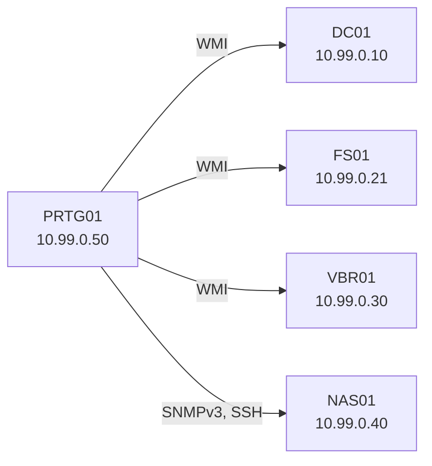

# 02.1 Monitoring der Backup-Umgebung mit PRTG

| | |
|---|---|
| **Modul** | 02 Monitoring mit PRTG |
| **Stufe** | Aufbau |
| **Geschätzte Zeit** | 4 bis 5 Stunden (Schätzung) |
| **Werkzeuge** | PRTG Network Monitor (Freeware), Hyper-V, Windows Server, Debian, PowerShell, Bash |
| **Vorwissen** | Übung 01.1 (Backup auf NAS mit Veeam), Grundlagen zu SNMP und WMI |

> [!WARNING]
> **Stand der Prüfung: Entwurf.** PRTG wurde **nicht** ausgeführt. Die Skripte wurden getestet: der Sensor in Bash und in PowerShell mit echten Testdateien (die Ausgabe ist gültiges XML), die übrigen mit nachgebauten Befehlen (Active Directory, Hyper-V, `apt`, `systemctl`). Das XML-Format der Sensoren, die Ablageorte der Skripte und die Lizenzbedingungen stammen aus dem Paessler-Handbuch (siehe Quellen). **Menünamen und Sensornamen der PRTG-Oberfläche stammen nicht aus einer geprüften Quelle** und sind mit *nicht bestätigt* markiert. Bitte nachbauen und Abweichungen melden.

## Lernziele

Nach dieser Übung kannst du

- einen PRTG-Server planvoll aufbauen: Gerätebaum, Vererbung der Zugangsdaten, überschaubare Sensorzahl,
- einen Windows-Server mit einem Dienstkonto ohne Administratorrechte per WMI überwachen,
- einen Linux-Server per SNMPv3 und SSH überwachen,
- mit einem eigenen Sensor prüfen, ob die Veeam-Sicherung **wirklich** aktuell ist, unabhängig von der Erfolgsmeldung in Veeam,
- Ausfälle im Labor auslösen und das Verhalten der Alarme beurteilen (Abhängigkeiten, Grenzwerte),
- den Überwachungsserver selbst absichern und sichern.

## Voraussetzungen

- Die Umgebung aus Übung 01.1 läuft: `DC01`, `FS01`, `VBR01`, `NAS01` im privaten Switch `vSwitch-Backup-Uebung` (10.99.0.0/24). Die Sicherung auf `NAS01` hat mindestens einmal funktioniert.
- Eine fünfte VM **PRTG01** (Windows Server, 2 vCPU, 4 GB RAM, 60 GB Platte) im selben Switch.
- Ein Konto mit Domänenadministrator-Rechten für die Einrichtung (nur dafür).
- PRTG von Paessler. Die Testversion läuft 30 Tage und wird danach automatisch zur Freeware mit bis zu 100 Sensoren (Quelle: Paessler-Handbuch „Available Licenses“). Die Freeware gibt es laut Handbuch nur, wenn zuerst die Testversion installiert wird. PRTG ist Kommerzsoftware und nicht Teil dieses Repositories.

## Grundbegriffe

| Begriff | Bedeutung |
|---|---|
| **Agentenlos** | Auf den überwachten Geräten wird nichts installiert. PRTG fragt sie über Standardprotokolle ab. |
| **Sensor** | Eine einzelne Messung (zum Beispiel „Ping“ oder „freier Platz auf C:“). PRTG lizenziert nach Sensoren. |
| **WMI** | Windows-Schnittstelle für Systemdaten. Läuft über DCOM und braucht ein Konto mit Leserechten. |
| **SNMP** | Protokoll für Geräte- und Serverdaten. Version 3 prüft Benutzer und verschlüsselt. Version 2c schickt nur einen „Community-String“ im Klartext. |
| **Vererbung** | Einstellungen (zum Beispiel Zugangsdaten) gelten für alles unterhalb einer Gruppe, bis ein Gerät sie überschreibt. |
| **Abhängigkeit** | Fällt das übergeordnete Gerät aus, werden die Sensoren darunter nicht auch rot, sondern pausiert. |

## Topologie

<!-- tikz:topologie -->


| VM | Rolle in dieser Übung | Adresse |
|---|---|---|
| PRTG01 | Überwachungsserver (neu) | 10.99.0.50/24, DNS 10.99.0.10 |
| DC01, FS01, VBR01 | Windows, Abfrage per WMI | wie in 01.1 |
| NAS01 | Linux, Abfrage per SNMPv3 und SSH, eigener Sensor | 10.99.0.40 |

Alle Namen und die Domäne `alpenwerk.example` sind erfunden. Zugangsdaten sind Übungswerte.

## Aufgabe

### Teil 1: Server und Struktur

**1. PRTG01 vorbereiten**

- **GUI:** Hyper-V-Manager → neue VM `PRTG01`, Switch `vSwitch-Backup-Uebung`. Windows Server installieren, Adresse 10.99.0.50/24, DNS 10.99.0.10, in die Domäne `alpenwerk.example` aufnehmen.
- **CLI:** (auf dem Host)

```powershell
New-VM -Name PRTG01 -Generation 2 -MemoryStartupBytes 4GB -NewVHDPath D:\VMs\PRTG01.vhdx -NewVHDSizeBytes 60GB -SwitchName vSwitch-Backup-Uebung
Set-VMProcessor -VMName PRTG01 -Count 2
```

Der Pfad `D:\VMs` ist ein Beispiel. Windows-Installation und Domänenbeitritt erfolgen wie in Übung 01.1.

**2. PRTG installieren, Erst-Scan abbrechen**

- **GUI:** Testversion auf PRTG01 herunterladen und mit Administratorrechten installieren. Nach der Installation bietet das Programm eine automatische Suche im Netz an (nicht bestätigt, wie der Dialog heißt). **Brich sie ab.** Eine ungezielte Suche legt für jedes gefundene Gerät viele Sensoren an. Mit 100 Sensoren in der Freeware ist das Limit schnell erreicht, und der Baum ist unübersichtlich.
- **CLI:** Entfällt, grafische Installation.

**3. Dienstkonto für WMI anlegen**

PRTG bekommt Leserechte, keine Administratorrechte. Das Skript legt das Konto an und nimmt es in die Gruppen *Performance Log Users* und *Distributed COM Users* auf.

- **GUI:** Active-Directory-Benutzer und -Computer → neuer Benutzer `svc_prtg_wmi`, Kennwort läuft nie ab, in die beiden Gruppen aufnehmen. Auf einer deutschen Windows-Version heißen die Gruppen anders (*Leistungsprotokollbenutzer*, *DCOM-Benutzer*).
- **CLI:** (auf `DC01`, administrative PowerShell)

```powershell
.\02.1-monitoring-benutzer.ps1 -WhatIf
.\02.1-monitoring-benutzer.ps1
```

Das Skript gibt das Kennwort nicht aus. Es bricht ab, wenn es die Gruppen nicht unter dem englischen Namen findet. Auf Mitgliedsservern (`FS01`, `VBR01`) gelten die beiden Gruppen **lokal**. Das Konto wird dort per Gruppenrichtlinie („Eingeschränkte Gruppen“) oder von Hand in *lokale Benutzer und Gruppen* aufgenommen.

**WMI-Namespace-Recht (nicht bestätigt):** Die Gruppenmitgliedschaft reicht nach meiner Kenntnis nicht allein. Auf jedem überwachten Windows-Server: `wmimgmt.msc` → Rechtsklick *WMI-Steuerung* → *Eigenschaften* → *Sicherheit* → Namespace `Root\CIMv2` → *Sicherheit* → das Konto hinzufügen mit den Rechten *Konto aktivieren* und *Remote aktivieren*. Prüfe es mit dem Sensortest in Schritt 8. Schlägt er fehl, ist dieses Recht der erste Verdacht.

**4. Gerätebaum und Zugangsdaten auf Gruppenebene**

Struktur: *Standort* → *Segment* → *Gerät* → *Sensor*.

- **GUI:** In PRTG eine Gruppe `Standort Wien` anlegen, darunter `Backup-Labor`. Unter `Backup-Labor` die vier Geräte anlegen (`DC01`, `FS01`, `VBR01`, `NAS01`, jeweils mit IP-Adresse). Dann in den **Einstellungen der Gruppe `Backup-Labor`** die Zugangsdaten eintragen (nicht bestätigt, wie die Bereiche heißen; gemeint sind die Bereiche für Windows-Systeme, Linux/SSH und SNMP):
  - Windows: Domäne `ALPENWERK`, Benutzer `svc_prtg_wmi`.
  - Linux: Benutzer `prtgmon` (entsteht in Schritt 5).
  - SNMP: Version 3, Benutzer `prtgmon`, SHA, AES (entstehen in Schritt 5).
- **CLI:** Entfällt, nur grafisch.

Die Zugangsdaten stehen **nur auf der Gruppe**, nie am einzelnen Gerät. Bei einer Kennwortänderung ist es dann eine Stelle.

### Teil 2: Geräte anbinden

**5. NAS01 für SNMPv3 und SSH vorbereiten**

Das Skript installiert `snmpd`, legt einen SNMPv3-Benutzer an (nur Lesezugriff), richtet das Konto `prtgmon` für SSH-Sensoren ein und gibt ihm Leserechte auf den Sicherungsordner.

- **GUI:** Entfällt.
- **CLI:** (auf `NAS01`, als root)

```bash
sudo bash 02.1-snmp-auf-nas.sh
```

Das Skript fragt zwei Kennwörter (SHA, AES, mindestens 8 Zeichen) und das Anmeldekennwort für `prtgmon`. Es setzt außerdem `agentaddress udp:161`. Ohne diese Zeile hört `snmpd` in der Debian-Grundeinstellung nach meiner Kenntnis nur auf `localhost` (nicht bestätigt).

Prüfen von einem anderen Linux-Rechner mit dem Paket `snmp` (zum Beispiel einer Test-VM):

```bash
snmpget -v3 -l authPriv -u prtgmon -a SHA -A '<auth>' -x AES -X '<priv>' 10.99.0.40 1.3.6.1.2.1.1.1.0
```

Erwartet (sinngemäß): Die Zeile `SNMPv2-MIB::sysDescr.0 = STRING: Linux NAS01 ...`. Die Kennwörter stehen hier in der Befehlszeile und in der Verlaufsdatei der Shell. Das ist in der Übung hinnehmbar, in der Praxis nicht.

**6. Sensoren planen, bevor man sie anlegt**

Die Freeware hat 100 Sensoren. Nicht alles Messbare ist wichtig. Plane vorher, was bei einem Ausfall zu einer Entscheidung führt.

| Gerät | Sensor (Name sinngemäß) | Anzahl |
|---|---|---|
| alle vier | Ping | 4 |
| DC01, FS01, VBR01 | CPU-Last, Arbeitsspeicher, freier Platz auf C: (jeweils WMI) | 9 |
| VBR01 | Windows-Dienst „Veeam Backup Service“ | 1 |
| NAS01 | Betriebszeit (SNMP), freier Platz Sicherungsordner (SSH oder SNMP), Datenverkehr (SNMP) | 3 |
| NAS01 | eigener Sensor „Alter neueste Sicherung“ (Schritt 9) | 1 |
| **Summe** | | **18** |

Der Dienstname des Veeam-Dienstes ist *nicht bestätigt*. Lies ihn in `services.msc` auf `VBR01` ab, bevor du den Sensor anlegst. 18 von 100 Sensoren bleiben weit unter dem Limit, so ist Platz für Erweiterungen.

**7. Sensoren anlegen**

- **GUI:** Pro Gerät: Rechtsklick → *Sensor hinzufügen* → die Sensortypen aus der Tabelle (Namen sinngemäß: *Ping*, *WMI CPU Load*, *WMI Memory*, *WMI Free Disk Space*, *Windows Service* bzw. *WMI Service*, *SNMP System Uptime*, *SNMP Traffic*, *SSH Disk Free*). Die genauen Namen und der Weg dorthin sind nicht bestätigt.
- **CLI:** Entfällt, nur grafisch.

**8. Prüfen, ob die Werte ankommen**

Nach 1 bis 2 Minuten müssen alle Sensoren grün sein und Werte zeigen. Bei einem WMI-Fehler (Zugriff verweigert) zuerst das WMI-Namespace-Recht aus Schritt 3 prüfen, dann die Windows-Firewall auf dem Ziel (Regeln für „Windows-Verwaltungsinstrumentation“, nicht bestätigt, wie die Regelgruppe heißt) und die Namensauflösung.

### Teil 3: Eigener Sensor, Ausfälle, Betrieb

**9. Sensor „Alter neueste Sicherung“ (Linux, SSH Script Advanced)**

Warum ein eigener Sensor: Veeam meldet „Erfolgreich“, solange Veeam selbst läuft. Ob auf dem NAS eine frische Sicherungsdatei liegt, beantwortet ein **unabhängiger** Blick auf die Dateien.

- **GUI:** Auf `NAS01` das Skript ablegen, dann in PRTG am Gerät `NAS01` einen Sensor vom Typ *SSH Script Advanced* anlegen, das Skript wählen und als Parameter `/srv/backup/veeam 26 50` eintragen (Pfad, Warnung ab Stunden, Fehler ab Stunden).
- **CLI:** (auf `NAS01`)

```bash
sudo install -m 755 02.1-prtg-backup-alter.sh /var/prtg/scriptsxml/
sudo -u prtgmon /var/prtg/scriptsxml/02.1-prtg-backup-alter.sh /srv/backup/veeam 26 50
```

Laut Paessler-Handbuch gehört das Skript in `/var/prtg/scriptsxml`, muss ausführbar sein und das Ergebnis als XML auf die Standardausgabe schreiben.

Erwartet (sinngemäß):

```text
<prtg>
  <result>
    <channel>Alter neueste Sicherung</channel>
    <value>3.4</value>
    ...
  </result>
  <result>
    <channel>Anzahl Sicherungsdateien</channel>
    <value>12</value>
  </result>
  <text>Neueste Datei: ...vib</text>
</prtg>
```

Die Werte hängen von deinem Backup ab.

**Wichtig laut Handbuch:** PRTG wendet Grenzwerte aus dem Skript **nur an, wenn der Kanal neu angelegt wird**. Änderst du später die Zahlen im Parameter, ändert sich ein bestehender Sensor nicht. Dann in den Kanaleinstellungen ändern oder den Sensor neu anlegen.

*Variante für Windows (EXE/Script Advanced):* `02.1-prtg-backup-alter.ps1` liefert dieselbe Ausgabe und gehört in den Ordner `Custom Sensors\EXEXML` des PRTG-Programmordners. Es läuft auf dem **PRTG-Server**, nicht auf dem Zielgerät. Ein Netzwerkpfad muss für das Konto des PRTG-Dienstes lesbar sein (nicht bestätigt, wie man das in PRTG am saubersten löst). Für diese Übung reicht der Test lokal:

```powershell
.\02.1-prtg-backup-alter.ps1 -Pfad 'D:\Test' -WarnStunden 26 -FehlerStunden 50
```

**10. Ausfälle auslösen**

Löse jeden Fall einzeln aus und notiere, was PRTG anzeigt und wie lange es dauert.

| Fall | So auslösen | Erwartung (sinngemäß) |
|---|---|---|
| Netzausfall NAS | Auf dem Host: `.\02.1-ausfall-test.ps1 -VMName NAS01 -Sekunden 180` | Ping-Sensor von `NAS01` wird nach einem oder mehreren Prüfintervallen rot. Nach dem Wiederverbinden grün. |
| Sicherung zu alt | Testordner mit alter Datei (siehe unten) | Kanal wird gelb, bei Überschreitung des Fehlerwertes rot. |
| Last auf NAS | `stress-ng --cpu 2 --timeout 600` auf `NAS01` (Paket `stress-ng`) | Falls du einen CPU-Sensor für `NAS01` angelegt hast, überschreitet er seinen Grenzwert. |
| Dienst gestoppt | `Stop-Service VeeamBackupSvc` auf `VBR01` (Dienstname prüfen) | Dienst-Sensor wird rot. Danach `Start-Service`. |

*Sicherung zu alt, ohne echte Sicherung anzufassen:* Lege auf `NAS01` einen Testordner an und prüfe diesen:

```bash
mkdir -p /tmp/sensortest && touch -d '30 hours ago' /tmp/sensortest/test.vbk
/var/prtg/scriptsxml/02.1-prtg-backup-alter.sh /tmp/sensortest 26 50
```

Der Wert liegt bei etwa 30,0 Stunden und damit über der Warnschwelle (26) und unter der Fehlerschwelle (50). Mit `touch -d '60 hours ago'` liegt er über beiden. Erstelle in PRTG dafür einen zweiten, temporären Sensor und lösche ihn danach.

Das Ausfalltest-Skript verbindet den Adapter in einem `finally`-Block wieder, auch wenn du mit Strg+C abbrichst. Mit `-WhatIf` siehst du vorher, was passiert.

**11. Abhängigkeit einrichten**

Wenn `NAS01` nicht erreichbar ist, sind alle seine Sensoren rot. Das sind mehrere Alarme für eine Ursache.

- **GUI:** Am Gerät `NAS01` den Ping-Sensor als „Hauptsensor für die Abhängigkeit“ (nicht bestätigt, wie die Einstellung heißt) festlegen. Wiederhole Schritt 10, Netzausfall: Die übrigen Sensoren von `NAS01` sollen pausiert statt rot sein.
- **CLI:** Entfällt, nur grafisch.

**12. PRTG01 absichern und sichern**

Der Server kennt Zugangsdaten zu allen überwachten Systemen. Er ist ein besonders schützenswertes Ziel.

- Weboberfläche nur über HTTPS. Den Zugriff auf die Oberfläche nur aus dem Verwaltungsnetz erlauben. Ein Beispiel für die Windows-Firewall (Port prüfen, in PRTG kann er abweichen):

```powershell
New-NetFirewallRule -DisplayName 'PRTG Web nur Verwaltung' -Direction Inbound -Protocol TCP -LocalPort 443 -RemoteAddress 10.99.0.0/24 -Action Allow
```

  Der Standard-HTTP-Port 80 gehört deaktiviert oder auf HTTPS umgeleitet (nicht bestätigt, wo das in PRTG einzustellen ist).
- Nimm `PRTG01` in den Sicherungsjob aus Übung 01.1 auf. Die PRTG-Konfiguration liegt im Datenordner, standardmäßig unter `%ProgramData%\Paessler\PRTG Network Monitor` (nicht bestätigt). Sie enthält Zugangsdaten, also nur verschlüsselt sichern.
- Prüfe nach einer Kennwortänderung des Kontos `svc_prtg_wmi`: Sie muss nur an einer Stelle erfolgen, auf der Gruppe.

## Hintergrund: Was passiert im Netzwerk?

### Warum agentenlos

PRTG fragt Geräte über WMI, SNMP, SSH und Ping ab. Es muss nichts auf den Zielen installiert, gepflegt oder aktualisiert werden. Dafür muss PRTG jede Anmeldung kennen, und die Ziele müssen die Abfragen zulassen. Der Preis ist Verwaltungsaufwand bei den Zugangsdaten, nicht bei Software.

### Vererbung der Zugangsdaten

Trägt man Zugangsdaten am Gerät ein, wiederholt man sie bei jedem Gerät. Auf der Gruppe gelten sie für alles darunter. Bei einer Kennwortrotation ist es dann ein Eintrag. Ein einzelnes Gerät kann abweichen und die Einstellung überschreiben.

### Warum SNMPv3

SNMPv2c schickt den Community-String im Klartext. Wer ihn mitliest, darf abfragen. SNMPv3 hat Benutzer, prüft sie (SHA) und verschlüsselt den Inhalt (AES). In dieser Übung bekommt der Benutzer nur Lesezugriff (`rouser`).

### Unabhängige Kontrolle statt Vertrauen in die Erfolgsmeldung

Das Sicherungsprogramm prüft sich selbst. Wenn es stehenbleibt oder das Ziel nicht mehr beschreibt, meldet es nichts. Der Sensor „Alter neueste Sicherung“ schaut auf das Ergebnis, die Datei auf dem NAS, und merkt auch dann etwas, wenn Veeam schweigt. Das ist der Kern der Übung: Eine Sicherung gilt erst als vorhanden, wenn eine zweite, unabhängige Stelle sie bestätigt.

### Wie ein eigener Sensor funktioniert

PRTG startet das Skript, liest das XML von der Standardausgabe und legt je `<channel>` einen Messkanal an. Ein Fehler wird als `<error>` ohne Kanäle gemeldet (laut Handbuch entweder Kanäle oder ein Fehler, nicht beides). Gleitkommazahlen brauchen `<float>1</float>`, sonst zeigt PRTG nach Handbuch Nullwerte. Deshalb steht in den Skripten ein Punkt als Dezimaltrenner.

### Alarmstürme und Abhängigkeiten

Ein ausgefallenes Gerät reißt alle seine Sensoren mit. Ohne Abhängigkeit entstehen viele Alarme für eine Ursache, und die wirkliche Ursache geht darin unter. Mit einer Abhängigkeit pausiert PRTG die Sensoren darunter, bis das Hauptgerät wieder da ist.

### Grenzen der Übung

- **Keine echte Hardware:** Kabel ziehen und USV-Stecker ziehen sind im Labor nicht möglich. Der Netzausfall wird über den virtuellen Adapter nachgebildet, eine USV nur als Erweiterung.
- **Menünamen in PRTG** sind nicht geprüft, weil PRTG nicht ausgeführt wurde.

## Hinweise

- Das Dienstkonto bekommt **keine** Administratorrechte. Wenn etwas nicht geht, suche das fehlende Einzelrecht, statt das Konto zum Administrator zu machen.
- Lege nicht zu viele Sensoren an. Je mehr Sensoren, desto mehr Pflege und desto weniger Aufmerksamkeit pro Alarm.
- Die Prüfintervalle sind einstellbar. Ein kürzeres Intervall bedeutet mehr Last und schnellere Meldung.
- Alle Kennwörter in dieser Übung sind Übungswerte, die du selbst vergibst. Verwende sie nie in einem echten Netz.

## Prüfbefehle

| Aufgabe | Befehl | GUI-Weg |
|---|---|---|
| SNMPv3 erreichbar | `snmpget -v3 ...` (Schritt 5) | Sensor *SNMP System Uptime* |
| Sensor-Skript auf NAS | `sudo -u prtgmon /var/prtg/scriptsxml/02.1-prtg-backup-alter.sh <Pfad> 26 50` | Sensor *SSH Script Advanced* |
| Sensor-Skript lokal (Windows) | `.\02.1-prtg-backup-alter.ps1 -Pfad <Pfad>` | – |
| Konto in Gruppen | `Get-ADGroupMember 'Performance Log Users'` | Active Directory-Benutzer und -Computer |
| Adapter des NAS | `Get-VMNetworkAdapter -VMName NAS01` | Hyper-V-Manager → Einstellungen |
| Dienststatus Veeam | `Get-Service *Veeam*` auf `VBR01` | `services.msc` |

**Kontrollfragen**

1. Warum stehen die Zugangsdaten auf der Gruppe und nicht am Gerät?
2. Warum bekommt das WMI-Konto keine Administratorrechte, und was braucht es stattdessen?
3. Warum reicht die Erfolgsmeldung von Veeam nicht aus?
4. Wann wendet PRTG die Grenzwerte aus dem Skript an, und was folgt daraus?
5. Was unterscheidet einen Alarm mit Abhängigkeit von einem ohne?
6. Warum steht in der Sensorplanung eine Summe, obwohl das Limit weit entfernt ist?

## Erweiterungen

- Eine USV per SNMP nachbilden (zum Beispiel mit einem Werkzeug, das SNMP-Geräte nachspielt, nicht geprüft) und die Batteriekanäle überwachen.
- E-Mail-Benachrichtigung bei Rot, mit einem lokalen Testmailserver.
- Eine PRTG-Karte (Übersichtsseite) für das Backup-Labor.
- Eine Remote Probe auf einer zweiten VM für ein weiteres Netz.
- Den Bericht aus Übung 01.1 (`01.1-backup-bericht.ps1`) als zweiten Sensor einbinden.

## Musterlösung

<details>
<summary>Musterlösung anzeigen</summary>

### Erwartete Zustände

| Schritt | Erwartung |
|---|---|
| 3 | `svc_prtg_wmi` ist Mitglied in *Performance Log Users* und *Distributed COM Users*. Ein zweiter Lauf ändert nichts. |
| 5 | `snmpget` liefert `sysDescr`. Ein Zugriff mit falschem Kennwort scheitert (Fehler zur Authentifizierung). |
| 6 | Summe 18 Sensoren. |
| 8 | Alle Sensoren grün. |
| 9 | Das Skript liefert gültiges XML mit den Kanälen „Alter neueste Sicherung“ und „Anzahl Sicherungsdateien“. |
| 10 | Netzausfall: Ping rot, danach grün. Zu alte Sicherung: gelb bei 30 Stunden, rot bei 60. |
| 11 | Beim Netzausfall sind die anderen Sensoren von `NAS01` pausiert. |

### Antworten auf die Kontrollfragen

1. Eine Änderung (Rotation, Wechsel des Kontos) ist dann ein Eintrag, nicht ein Eintrag je Gerät.
2. Ein Administratorkonto wäre bei Missbrauch auf allen Servern verwendbar. Dieses Konto braucht nur Leserechte über die beiden Gruppen und das Recht auf den WMI-Namespace.
3. Veeam prüft sich selbst. Steht es still oder schreibt nicht mehr, meldet es nichts. Eine unabhängige Prüfung der Datei bemerkt es.
4. Nur beim Anlegen des Kanals. Spätere Änderungen im Skript wirken nicht, die Grenzen müssen im Kanal geändert oder der Sensor neu angelegt werden.
5. Ohne Abhängigkeit entsteht pro betroffenem Sensor ein Alarm. Mit Abhängigkeit wird nur die Ursache gemeldet.
6. Weil jeder Sensor Pflege und Aufmerksamkeit kostet. Die Planung hilft, nur zu überwachen, was eine Entscheidung auslöst.

</details>

## Quellen

Stand der Abfrage: 2026-11-06.

- [PRTG Manual: Custom Sensors](https://manuals.paessler.com/custom_sensors.htm): XML-Format (`<prtg>`, `<result>`, `<channel>`, `<value>`, `<float>`, Grenzwert-Elemente, `<error>`, `<text>`), Ablageort `Custom Sensors\EXEXML` und `/var/prtg/scriptsxml`.
- [PRTG Manual: SSH Script Advanced Sensor](https://prtg.neam.de/help/ssh_script_advanced_sensor.htm): Ablage auf dem Ziel, ausführbar, Ausgabe auf der Standardausgabe. Es handelt sich um eine Kopie des Handbuchs auf einer fremden PRTG-Installation, nicht um Paessler selbst.
- [PRTG Manual: Available Licenses](https://www.paessler.com/manuals/prtg/available_licenses): Testversion 30 Tage, danach Freeware bis 100 Sensoren, Freeware nur über die Testversion.

**Nicht gegen eine Quelle geprüft** (aus eigener Kenntnis, bitte gegenprüfen): alle Menü- und Sensornamen der PRTG-Oberfläche, das WMI-Namespace-Recht, die Windows-Firewall-Regelgruppe für WMI, der Dienstname `VeeamBackupSvc`, der Datenordner von PRTG, das Standardverhalten von `snmpd` unter Debian (nur `localhost`), die Gruppennamen in deutschen Windows-Versionen.

---
Lizenz: Dieses Dokument steht unter [CC BY-NC-SA 4.0](https://creativecommons.org/licenses/by-nc-sa/4.0/deed.de), Urheber AnsibleArtisan4711. Die Skripte stehen unter der MIT-Lizenz. PRTG und Paessler sind Marken der Paessler GmbH, Veeam ist eine Marke von Veeam Software, Microsoft, Windows und Active Directory sind Marken der Microsoft-Gruppe, Debian ist eine Marke ihrer Inhaber. Dieses Dokument ist nicht mit diesen Unternehmen verbunden.
